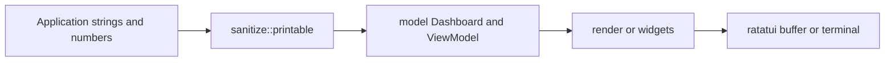

# fw-tui

[](https://github.com/ddproxy/fw-tui/actions/workflows/ci.yml?query=branch%3Amain)
[](https://github.com/ddproxy/fw-tui/actions/workflows/codeql.yml)
[](https://scorecard.dev/viewer/?uri=github.com/ddproxy/fw-tui)
[](https://github.com/ddproxy/fw-tui/releases/latest)
[](LICENSE)

Status: preview, v0.1.0. The public API is small and this release has no breaking API changes. There is no 1.0 promise yet.

`fw-tui` is a Rust library of reusable terminal dashboard widgets with a model that builds without a terminal library.

## What and why

Most TUI widgets take application types and trust whatever text they are given. This crate separates a pure, testable model from drawing, then escapes untrusted strings at both the constructor and the terminal boundary. The result is a small set of data-agnostic widgets that survive hostile input, tiny terminals and resizes without panicking. Unsafe code is forbidden at the crate level.



## Install

From a checkout of the source:

`git clone https://github.com/ddproxy/fw-tui.git && cd fw-tui`

Read `Cargo.toml` and `src/` before trusting the source, then run `cargo test --locked`. There is no binary or installer for this crate, and `Cargo.toml` sets `publish = false`. The manual alternative is a path dependency in your own `Cargo.toml`, described in [install](docs/install.md). Rust 1.99 or newer is required.

## Quickstart (10 minutes)

1. Confirm the checkout is this crate.

   ```sh
   test -f Cargo.toml && grep -q '^name = "fw-tui"' Cargo.toml && echo 'PASS source checkout'
   # expect: PASS source checkout
   ```

   Expected: `PASS source checkout`.

2. Run the tests. The model and sanitizer need no terminal or feature flags.

   ```sh
   out="$(cargo test --locked 2>&1)"; printf '%s\n' "$out" | grep -F -m1 'test result: ok.'
   # expect: test result: ok.
   ```

   Expected: a line beginning `test result: ok.`. The default-feature run reports 13 unit tests and 21 doc tests.

3. Proof: render the gallery without a terminal and assert that it drew its title.

   ```sh
   cargo run --locked --features tui --example gallery -- --once | grep -F 'fw-tui gallery' | sed 's/.*fw-tui gallery.*/PASS gallery renders/'
   # expect: PASS gallery renders
   ```

   Expected: `PASS gallery renders`. The full `--once` output is a 100 by 30 cell plain-text frame.

Next: [CLI reference](docs/cli.md) for the interactive keys, or [quickstart](docs/quickstart.md) for the same steps with more detail.

## How it works

`model` and `sanitize` always build. They hold the rows, pause state and plain-text view, and turn control characters and invisible format characters into `?`. The `tui` feature adds `render`, `run`, `terminal`, `text`, `theme` and `widgets`, which use ratatui 0.30 and crossterm 0.29. Drawing helpers escape again at the buffer boundary, so a publicly constructed struct cannot inject terminal sequences. See [architecture](docs/architecture.md).

## Configuration

There is no config file or daemon. The knobs below are code-level defaults; the full table is in [configuration](docs/configuration.md).

| Key | Default | Meaning |
| --- | --- | --- |
| Cargo feature `tui` | off | Enables widgets, theme, text helpers, terminal guard and demo loop. |
| `NO_COLOR` | unset | Any value, even an empty one, selects `Theme::monochrome()` in `Theme::auto()`. |
| `LineChartConfig.zoom` | `1` | Samples combined per point. Values below one act as one. |
| `LineChartConfig.agg` | `ZoomAgg::Max` | Bucket reduction. `ZoomAgg::Mean` is the other option. |
| `LineChartConfig.focused` | `0` | Highlighted series index. Out-of-range values clamp when drawn. |
| `Scale` | `Scale::Auto` | Sparkline and bar scaling. `Fixed(v)` applies only when `v` is finite and above zero. |
| `mask` level | caller-supplied | `0` leaves text, `1` abbreviates the middle, `2` gives a stable short label. Level 2 and above behave alike. |
| `Gauge.fraction` | caller-supplied | NaN or negative draws empty; above 1 or infinite draws full. |
| `Dashboard` names | empty | Rows start at count zero. `tick()` applies a demo step, not a network feed. |

The minimal and full examples both compile in CI: `cargo check --locked --example config_minimal` and `cargo check --locked --features tui --example config_full`. See `examples/` and [configuration](docs/configuration.md).

## Operating it

### Upgrade and rollback

Fetch the newer tag with `git pull --ff-only`, review the [changelog](CHANGELOG.md), then run `make check`. To roll back, check out the previous tag and rerun `cargo test --locked`. `Cargo.lock` is committed and checks use `--locked`, so a dependency change needs a regenerated lockfile.

### Backup and restore

The crate has no runtime state, database or cache. Back up the source checkout and `Cargo.lock`; restoring those two is sufficient.

### Logs and metrics

The library emits no logs and exposes no metrics endpoints. `cargo test` prints test counts, CI records check results, and `scripts/check_workflows.sh` prints `workflow checks passed` on success.

### Health checks

Run `make check` for formatting, clippy with warnings denied, rustdoc, tests and docs checks. Run `bash scripts/check_workflows.sh` for workflow pins, permissions and licence sync. Run `make docs-check` for docs structure, links, quickstart proof and drift.

### Verify a release

Requires `gh`, `sha256sum` and network access. Replace the tag with the one you are verifying.

```sh
tag=v0.1.0
gh release download "$tag" --repo ddproxy/fw-tui \
  --pattern "fw-tui-${tag}-source.tar.gz" \
  --pattern "fw-tui-${tag}-sbom.json" \
  --pattern checksums.txt

gh attestation verify "fw-tui-${tag}-source.tar.gz" --repo ddproxy/fw-tui
sha256sum --check checksums.txt
```

### Common failures

The exact messages and fixes are in [troubleshooting](docs/troubleshooting.md). Two frequent cases:

| Message | Fix |
| --- | --- |
| `error[E0433]: cannot find \`theme\` in \`fw_tui\`` | Add `--features tui` or enable the feature in `Cargo.toml`. |
| `error: cannot update the lock file ... because --locked was passed to prevent this` | Regenerate `Cargo.lock` with `cargo generate-lockfile`, review the diff and commit it. |

## Security model

The crate protects the screen from untrusted strings and hostile numbers. `printable` replaces control characters, bidi overrides and invisible format characters with `?`. Widget constructors and drawing code both apply it. Fractions, counts and indices are clamped; empty lists and zero-sized areas draw nothing instead of panicking. `TerminalGuard` restores raw mode and the alternate screen on drop and on panic. Unsafe code is forbidden.

The crate does not authenticate users, encrypt data, store credentials, open sockets, validate file paths or sandbox the terminal emulator. Callers own the data they pass in. The trust boundary is the application calling this library; the terminal emulator is trusted to render the buffer it receives. In plain words: text handling fails closed, because unknown controls become `?`; layout fails safe, because hostile numbers clamp; there is no access-control decision that could fail open. See [security model](docs/security.md) and [SECURITY.md](SECURITY.md) for reporting.

## Compatibility matrix

Last checked on 2026-11-23.

| Component | Version last checked | Notes |
| --- | --- | --- |
| Rust toolchain | 1.99.1 | MSRV in `Cargo.toml` is 1.99, edition 2021. |
| ratatui | 0.30.2 | Requirement is 0.30; optional `tui` feature. |
| crossterm | 0.29.0 | Requirement is 0.29; optional `tui` feature. |
| Linux x86_64 | CI ubuntu-latest and local Linux | Default and all-feature tests pass. |
| macOS, Windows | not checked | crossterm targets exist; builds are unverified here. |
| ANSI terminal | not versioned | Interactive gallery needs a tty. `--once` needs none. |

## Limits and non-goals

- No binary, daemon, installer, config file, network client or persistence layer.
- No full Unicode grapheme or width algorithm. The local table counts common wide and combining ranges; some scripts will measure imperfectly.
- The line chart draws at most 16 series and reports the rest as `+N` in the legend.
- Table headers clip to 20 display cells and cell values to 40. Gauge labels clip to 12 cells and right text to 8.
- The privacy mask is deterministic, not cryptographic. It is for screenshots, not for protecting data.
- The demo loop polls keys every 100 ms. It is a demo, not an event framework.
- No 1.0 API promise and no crates.io publication at this version.

## FAQ

**Does the model need a terminal?** No. `Dashboard`, `ViewModel` and `sanitize` build with default features and are covered by doc tests.

**Does `--once` use my theme settings?** No. It always renders monochrome. Interactive mode uses `Theme::auto()`, which reads `NO_COLOR`.

## Contributing and development

| Command | What it runs |
| --- | --- |
| `make help` | Lists targets. |
| `make build` | Builds with default features and with all features. |
| `make test` | Tests with default features and with all features. |
| `make lint` | rustfmt check, clippy with `-D warnings`, rustdoc with `-D warnings`. |
| `make docs-check` | Docs files, relative links, quickstart proof, drift and example validation. |
| `make check` | Lint, tests and docs checks. |

Release process: tag `v*`; the release workflow builds a source archive, a CycloneDX SBOM, SHA-256 checksums and a build provenance attestation. Verification commands are above and in [security scanning](docs/security-scanning.md). Commit style: terse imperative subjects, no personal or job names. See [AGENTS.md](AGENTS.md).

## License

MIT. See [LICENSE](LICENSE). Docs: [index](docs/index.md), [security scanning](docs/security-scanning.md), [changelog](CHANGELOG.md).
