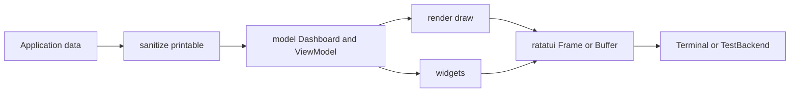

# Architecture

Who this is for: a contributor or reviewer who needs the module map and the reason for the feature boundary.

## Data flow

## Feature boundary

| Modules | Feature | Dependency on a terminal |
| --- | --- | --- |
| `model`, `sanitize`, private `width` | always on | none |
| `render`, `run`, `terminal`, `text`, `theme`, `widgets` | `tui`, off by default | ratatui 0.30 and crossterm 0.29 |

The model makes all text decisions. `ViewModel` holds plain strings for the title, rows, status and footer. The renderer only lays them out, then calls `printable` again at the buffer boundary. Widgets follow the same pattern: constructors escape input, draw functions escape again, because public fields can be set directly.

## Module map

| Path | Role |
| --- | --- |
| `src/model.rs` | Dashboard state, pause snapshots and plain-text view model. |
| `src/sanitize.rs` | Idempotent replacement of control and invisible characters with `?`. |
| `src/width.rs` | Private display-width helpers shared by model and text modules. |
| `src/render.rs` | Lays a view model onto a ratatui frame. |
| `src/run.rs` | Key mapping and the demo event loop. Key mapping is pure and tested without a tty. |
| `src/terminal.rs` | Terminal guard, panic hook and restore path. |
| `src/text.rs` | Buffer to text plus width, duration, count and byte helpers. |
| `src/theme.rs` | Semantic styles, dark and monochrome palettes, `NO_COLOR` selection. |
| `src/widgets/` | Panels, bars, tabs, table, dots, gauges, charts, overlay and privacy mask. |
| `scripts/check_docs.sh` | Docs structure, links, proof blocks, drift and example validation. |
| `scripts/check_workflows.rs` | Workflow pins, permissions, licence sync and Dependabot checks. |

## Testing strategy

- Unit tests cover model freeze and resume, escaping, width handling, clamping and every widget at zero-sized, narrow and wide areas, including resizes.
- Rustdoc examples cover every public item and run with default features and with all features.
- `make docs-check` executes the quickstart proof blocks, validates the two configuration examples and checks that documented tokens exist in code.
- CI runs rustfmt, clippy with `-D warnings`, tests with both feature sets, rustdoc with warnings denied, audit, CodeQL and dependency review.

See [limits](limits.md) for the numeric clamps and [security model](security.md) for the trust boundaries.
